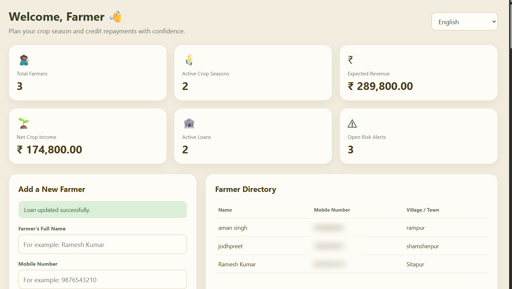
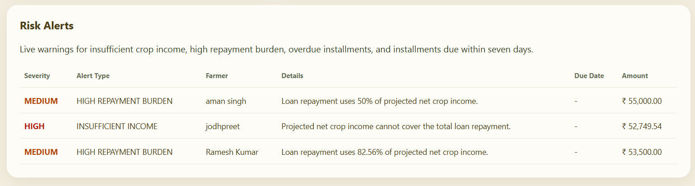
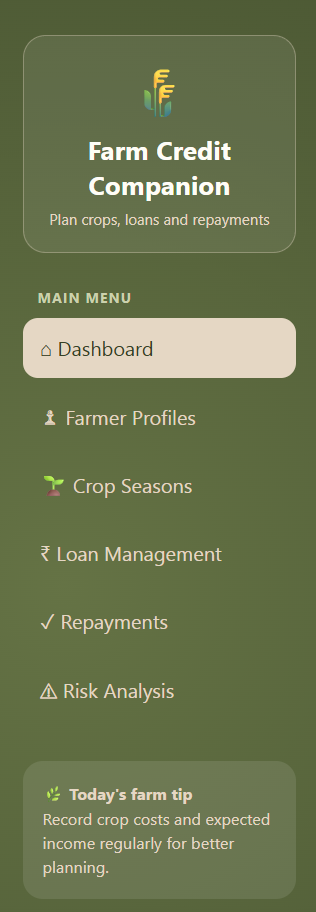
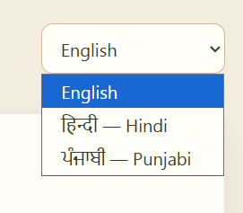
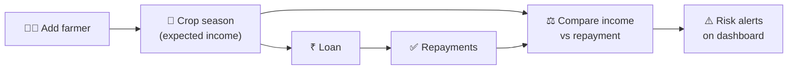
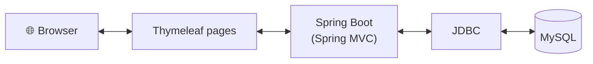

<div align="center">

# 🌾 Farm Credit Companion
### Seasonal Credit Planner

**A season-aware farm credit planning and repayment feasibility system**
built with Spring Boot, JDBC and MySQL.


<br>



</div>

---

## 💡 The Idea

Farm income is **seasonal**, but loan installments usually are not. A farmer can earn well over a year and still struggle in the months between harvests.

Farm Credit Companion asks one practical question before a loan becomes a burden:

> *Can the expected income from this crop season actually cover this loan's repayment?*

The system records farmers, crop seasons, loans and repayments, compares projected crop income against repayment obligations, and raises **risk alerts** when the numbers do not add up.

---

## 🎓 About This Project

This is an **academic mini project** built to apply **Java, Object-Oriented Programming and JDBC** to a real-world problem.

Credit-planning and farm-management tools already exist, and this project is **not meant to compete with them**. It is a learning foundation: a working, end-to-end application where I practised modelling a domain with OOP, working with a relational database through JDBC, and building a usable web interface on top.

It is a **starting point**, and I plan to keep extending it with new features and make it more unique over time.

---

## ✨ Features

| Module | What it does |
|---|---|
| 📊 **Dashboard** | Totals for farmers, active crop seasons, expected revenue, net crop income, active loans and open risk alerts |
| 👨‍🌾 **Farmer Profiles** | Add farmers (name, mobile number, village/town) and browse a farmer directory |
| 🌱 **Crop Seasons** | Track crop seasons and their income |
| ₹ **Loan Management** | Record and update loans |
| ✅ **Repayments** | Track repayment installments |
| ⚠️ **Risk Analysis** | Live alerts for insufficient crop income, high repayment burden, overdue installments and installments due within seven days |
| 🌐 **Multilingual UI** | English, Hindi (हिन्दी) and Punjabi (ਪੰਜਾਬੀ) |

---

## 🖼️ Screenshots

### Risk Analysis
Each alert shows its severity, type, the farmer involved, a plain-language explanation and the amount at stake.



### Navigation and Language Support

<table>
  <tr>
    <td align="center" width="50%">
      <br>
      <sub><b>Main menu</b></sub>
    </td>
    <td align="center" width="50%">
      <br>
      <sub><b>English · Hindi · Punjabi</b></sub>
    </td>
  </tr>
</table>

---

## 🔄 How It Works





---

## 🛠️ Tech Stack

| Layer | Technology |
|---|---|
| Language | Java 21 |
| Framework | Spring Boot 4.1 (Spring MVC) |
| Data access | JDBC |
| Database | MySQL |
| Templating | Thymeleaf |
| Validation | Bean Validation |
| Build tool | Maven (with Maven Wrapper) |

---

## 🚀 Run Locally

You need **JDK 21**, **MySQL** and **Git**.

```bash
git clone https://github.com/Khushdeep23/seasonal-credit-planner.git
cd seasonal-credit-planner
```

Point the app at your MySQL database in `src/main/resources/application.properties`, then start it:

```bash
# Windows
mvnw.cmd spring-boot:run

# macOS / Linux
./mvnw spring-boot:run
```

Open **http://localhost:8080** in your browser.

---

## 🧭 Roadmap

Ideas for where this goes next:

- [ ] Login and role-based access
- [ ] Charts for income versus repayment
- [ ] Automated tests for the risk-evaluation logic
- [ ] Export reports as PDF or CSV
- [ ] Repayment reminders
- [ ] Cloud deployment
- [ ] More features to make it unique and useful for real farming communities

---

## 👤 Author

**Khushdeep**, Computer Science Engineering student

[](https://github.com/Khushdeep23)

*Feedback and suggestions are welcome.*

---

<div align="center">

⭐ If you found this project interesting, consider giving it a star.

*Built as a learning project, growing one feature at a time.*

</div>
